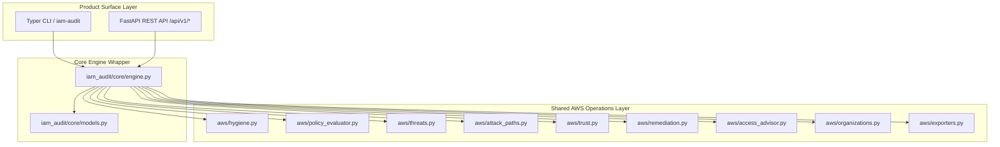

# IAM Access Auditor & Permission Analyzer v2.0 (Phase 5 Release Candidate)

A production-grade Python toolkit for reviewing AWS IAM users, groups, roles, policies, effective permissions, and privilege escalation attack paths. Includes a **FastAPI REST API**, a **Typer CLI**, **JSON/CSV/SARIF export**, **Safety-First Dry-Run Remediation**, and **Docker** support.

---

## 1. Architecture & Data Flow



---

## 2. Security Capabilities & IAM Authorization Semantics

### Evaluation Semantics Support Matrix

| Authorization Semantic | Status | Handling Details |
|------------------------|--------|------------------|
| **Explicit Deny Precedence** | **Supported & Tested** | Deny statements override Allows across all identity, boundary, and session policy sources |
| **Wildcard Action/Resource Matching** | **Supported & Tested** | Case-insensitive pattern matching (`fnmatchcase`) |
| **`NotAction` & `NotResource`** | **Supported & Tested** | Negative exclusion matching |
| **String / Numeric / Bool / Null / IpAddress / Arn Conditions** | **Supported & Tested** | Full operator evaluation including CIDR network calculations via standard `ipaddress` |
| **`*IfExists` Condition Suffix** | **Supported & Tested** | Bypasses check if key is absent from context |
| **Multivalued Context Keys** | **Supported & Tested** | List-to-list set intersection evaluation |
| **Policy Variables (`${aws:username}`)** | **Supported & Tested** | Expanded when context is provided; returns `decision="indeterminate"` when variable is unresolved |
| **Permissions Boundaries & Session Policies** | **Supported & Tested** | Evaluated in conjunction with identity policies |
| **Role Trust Policies & Cross-Account** | **Supported & Tested** | Audits `AssumeRolePolicyDocument` for `*`, cross-account IDs, `ExternalId`, and `PrincipalOrgID` |
| **Resource-Based Policies (S3, KMS)** | **Unsupported (Local Evaluator)** | Explicitly documented limitation; local evaluator returns `indeterminate` if evaluation relies on resource policies |
| **Service Control Policies (SCPs)** | **Unsupported (Local Evaluator)** | Explicitly documented limitation; local evaluator returns `indeterminate` if evaluation relies on SCPs |

---

## 3. Quick Start & Installation

### Prerequisites

- Python 3.10+
- AWS credentials configured (`~/.aws/credentials` or environment variables)
- IAM read-only permissions (`iam:List*`, `iam:Get*`, `iam:GenerateServiceLastAccessedDetails`, `sts:GetCallerIdentity`)

### Installation

```bash
pip install -r requirements.txt
pip install -e ".[all]"
```

---

## 4. Demonstrating the Project (CLI & API Usage)

### 1. Modern CLI (Typer)

```bash
# 1. Run a full security audit and display rich terminal summary tables
iam-audit audit

# 2. Export security findings to SARIF format (for GitHub Code Scanning / IDE integration)
iam-audit audit --format sarif --output findings.sarif

# 3. Export audit report to JSON format
iam-audit audit --format json --output audit_report.json

# 4. Analyze user permissions
iam-audit permissions alice --output alice.json

# 5. Check specific permission against identity, boundary, and session policies
iam-audit check alice s3:GetObject

# 6. Search users with specific permission
iam-audit search s3:PutObject

# 7. Compare permissions between two users
iam-audit compare alice bob
```

### 2. Remediation Script Generation (Safety-First)

```bash
# Generate remediation script in dry-run mode (Zero API network calls, zero file mutations)
python -m aws.remediation --account-id 123456789012 --dry-run

# Generate production remediation script with account identity guard & rollback commands
python -m aws.remediation --account-id 123456789012 --output-script remediate.sh

# Execute remediation with explicit user confirmation gate
bash remediate.sh
```

---

## 5. Opt-In Read-Only AWS Sandbox Validation Path

To run a manual, opt-in read-only verification scan against a dedicated AWS sandbox account:

```bash
# Step 1: Configure AWS CLI credentials for your dedicated test profile (Read-Only)
export AWS_PROFILE="my-sandbox-profile"
# Or set temporary environment credentials:
# export AWS_ACCESS_KEY_ID="AKIA..."
# export AWS_SECRET_ACCESS_KEY="..."
# export AWS_SESSION_TOKEN="..."

# Step 2: Verify active caller identity and target Account ID BEFORE auditing
aws sts get-caller-identity

# Step 3: Run read-only security audit using the Auditor CLI
iam-audit audit

# Step 4: Verify generated findings without modifying any live IAM resources
cat audit_report.json
```

> **Safety Guarantee**: The Auditor NEVER executes destructive operations, resource creations, or policy mutations against a live AWS account automatically.

---

## 6. Verification & Test Suite Commands

```bash
# Full Pytest Test Suite (104/104 Passing)
pytest

# Ruff Code Linter
python -m ruff check .

# Mypy Strict Type Checking
python -m mypy iam_audit aws
```

---

## 7. Verification Evidence Level

- **Locally Tested & Verified**: Policy semantics, condition operators, policy variables, permissions boundaries, session policies, threat detection, attack path correlation, Access Advisor right-sizing safeguards, SARIF/JSON/CSV export formats.
- **Mocked AWS Integration**: Subprocess remediation execution tests (`tests/test_runtime_remediation_execution.py`) using mocked AWS CLI binaries and Moto unit tests.
- **Live AWS Verification**: Opt-in read-only manual execution path (requires configured AWS credentials).

---

## License

MIT License. Developed by Google DeepMind team pair programming with satyanshcancode.
